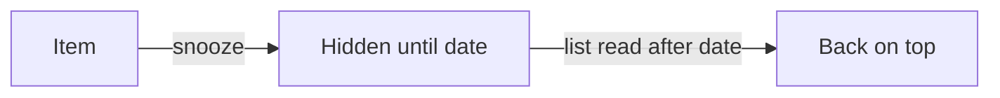

# The PR body

A reviewer reads the first screen, decides whether the change is safe and what they are asked to do, and opens the diff. The body exists for that read. Everything else is depth, and depth lives in the details comment or a repo doc.

## The skeleton

**A repo with a team template keeps the team's headings, in the team's order.** Map this content onto them, and add exactly one section, `## Review`, right after the summary heading. A team rule silent on a point inherits the default below.

**The default order**, for a repo with no template:

1. **Series line**, only in a series: `> Part k/n of <feature> · merges after <repo>#<n> · index: <link>`.
2. **`## Summary`:** what changes and why, one short paragraph, at most 60 words.
3. **`## Review`**, on the first screen. Up to four parts, each kept apart:
   - **Please decide:** at most 3 items, numbered, each addressed to a named reviewer (a plain name, never `@`).
   - **Please check:** at most 3 items, numbered, addressed, a file or area each.
   - **Risks:** at most 3, each with how it is contained.
   - **Before merging:** only when there is a deploy, migration, secret, env or timing step.
4. **`## What is changed`:**
   - the change **grouped by idea, never file by file**: no file lists, no per-file walkthroughs;
   - a visual where the visual rule below asks for one;
   - **Tested:** 2–3 lines: what ran, the result, and what was not run.
5. **`## Why`:**
   - the background the diff cannot show, in 2–4 sentences with links;
   - the key **decisions**, at most 5 bold-lead bullets, each giving the choice, the alternative and the reason.
6. **`## Related issue`:** `Closes #n`, `Refs …` or `None`, plus the links to the **details comment** (depth only this review needs: the full test log, long value lists, merge timing) and to any **repo doc** in the diff (depth that outlives the PR). Link them; never restate them.

There are no other standing sections. A question a teammate would ask is answered inside these sections, where it arises.

## Budgets, as `pr-check` measures them

- **First screen** (everything before the first heading after `## Review`): at most 1,500 reading chars, about 250 words.
- **Visible** (outside `<details>`): at most 3,500.
- **Whole source:** at most 6,000.

Only the author's text counts: link URLs, HTML comments and Mermaid source do not, and each whitespace run is one char. Over a budget, move depth out to the details comment or a repo doc. Never squeeze words or drop the asks to fit.

## The visual rule

- **Required** when the PR changes a flow (pipeline stages, a request path, state transitions), crosses two or more components, or passes the 400-line target: one Mermaid diagram (flowchart or sequence) **or** a before/after table.
- **Every Mermaid diagram gets a one-sentence prose caption** that stands without it: Mermaid does not render in email or `gh pr view`.
- **UI changes** need before/after screenshots. `gh` cannot upload images, so leave a marked spot, `<!-- screenshot: <screen>, before / after -->`, plus the visible line `_Screenshots: added in the draft preview._`, and remind the operator in the walkthrough (or the pass report) to drop the images in on GitHub while reading the draft.
- **Small fixes** stay plain text.

## Prose rules

- One idea per paragraph; terms defined at first use; shorter wins.
- **The subject, never the records:** no work log, no "not run" walls, no mutation counts beyond one number.
- **No workspace leakage:** no phase or slice IDs, no workspace paths or file names, and avoid the words "slice", "orchestrator" and "executor". The reviewer has never seen the workspace.
- **Percentiles in lower case** (`p95`), and never spell a version `P<n>`: `pr-check`'s ID check is case-sensitive and fails even inside code spans.
- **Language:** the team's rule, else the language of most of the team's recent PRs.
- **A port PR** says "port of <link>; review only these differences" and lists the files that differ.
- **Names** are plain text in a draft; the reviewer requests go out at Ready.

## A small example (invented)

A toy feature in a toy repo, about 1,200 reading chars. It shows the shape and the length, not a template to copy.

````markdown
## Summary

Shopping-list items can now be snoozed until a date. A snoozed item leaves the list and comes back on its date, so people stop deleting and re-adding things they buy monthly.

## Review

**Please decide**
1. Dana: should a snoozed item come back at the top of the list or in its old spot? The draft puts it on top.

**Please check**
1. Lee: the date math in the snooze reader, around midnight and time-zone edges.

**Risks**
1. Existing lists gain a nullable column; old rows read as "not snoozed", so nothing changes for them.

## What is changed

- **Snoozing.** An item stores an optional wake-up date; the list hides it until then.
- **Waking.** Reading the list wakes every item whose date has passed, so there is no background job.



An item goes from visible, to hidden until its date, to back on top at the first read after that date.

**Tested:** the unit suite passes, with new cases for midnight and DST edges. Not run: the mobile client.

## Why

Usage showed people deleting and re-adding the same items each month. **Wake on read, not a scheduled job:** a job was the alternative, but it adds a moving part for a list that is only seen when it is read.

## Related issue

Closes #42 · details: <link to the details comment>
````
